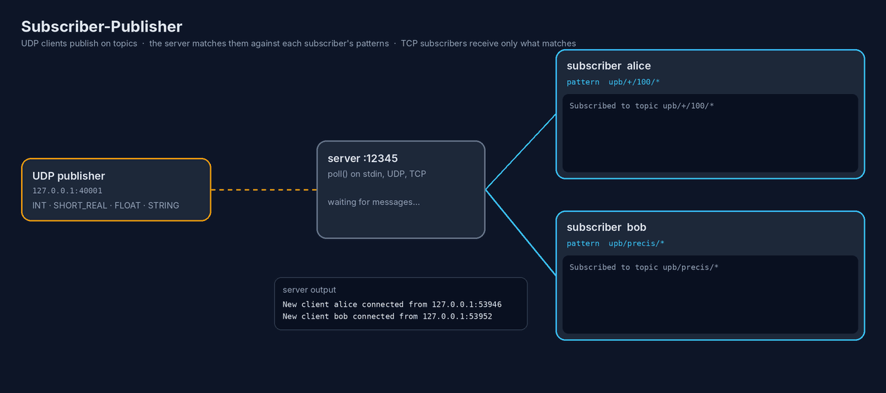
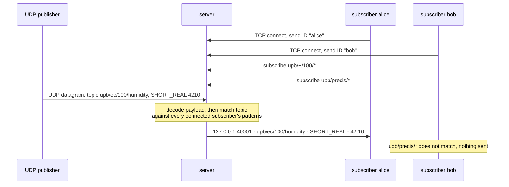

# Subscriber-Publisher

A topic-based **publish/subscribe message broker** written in C++ on top of raw POSIX sockets. UDP clients publish typed messages on topics, TCP subscribers register interest in topics (with `+` and `*` wildcards), and a single-threaded server built around `poll()` routes every message only to the subscribers whose patterns match.

Built as the second assignment for the *Communication Protocols* (PCOM) course.



*The animation replays a real run of the server: the topics, patterns and every output line come from the actual programs.*

---

## Contents

- [How it works](#how-it-works)
- [Topics and wildcards](#topics-and-wildcards)
- [Message format](#message-format)
- [The server](#the-server)
- [The subscriber](#the-subscriber)
- [Building and running](#building-and-running)
- [Example session](#example-session)
- [Design notes](#design-notes)

---

## How it works



There are three kinds of participants:

| Participant    | Transport | Role                                                                 |
|----------------|-----------|----------------------------------------------------------------------|
| **Publisher**  | UDP       | Sends binary datagrams: a topic, a data type and a value.             |
| **Server**     | UDP + TCP | Accepts subscribers, keeps their subscriptions, decodes and routes messages. |
| **Subscriber** | TCP       | Connects with a unique ID, subscribes/unsubscribes, prints what it receives. |

## Topics and wildcards

Topics are paths made of words separated by `/`, for example `upb/precis/100/temperature`. A subscription is a **pattern** that can be a plain topic or can contain wildcards:

| Wildcard | Matches                             | Example pattern     | Matches                          | Doesn't match            |
|----------|-------------------------------------|---------------------|----------------------------------|--------------------------|
| `+`      | exactly **one** word                | `upb/+/100/*`       | `upb/ec/100/humidity`            | `upb/precis/elevator/floor` |
| `*`      | **one or more** words               | `upb/precis/*`      | `upb/precis/100/temperature`     | `news/today`             |

Matching is done by `topic_matches()` with **dynamic programming** over the words of the pattern (`n`) and of the topic (`m`):

```
dp[0][0] = true                       // empty pattern matches empty topic

word is "+"  →  dp[i][j] = dp[i-1][j-1]                   // consume exactly one word
word is "*"  →  dp[i][j] = dp[i-1][j-1] || dp[i][j-1]     // consume one word, or keep extending
otherwise    →  dp[i][j] = dp[i-1][j-1] && word == topic[j]

match = dp[n][m]
```

Wildcards can appear anywhere in the pattern, any number of times, and the check runs in `O(n · m)`.

## Message format

### Publisher → server (UDP)

Every datagram has a fixed 50-byte topic, a 1-byte type, and a type-specific payload:

```
┌───────────────────────┬──────┬─────────────────────────────┐
│ topic (50 bytes,      │ type │ payload                     │
│ zero-padded)          │ 1 B  │ up to 1500 bytes            │
└───────────────────────┴──────┴─────────────────────────────┘
```

| Type | Name         | Payload                                                                   | Decoded as             |
|------|--------------|---------------------------------------------------------------------------|------------------------|
| 0    | `INT`        | sign byte (0 = +, 1 = −) + `uint32` in network order                      | `-2`                   |
| 1    | `SHORT_REAL` | `uint16` in network order = value × 100                                   | `4210` → `42.10`       |
| 2    | `FLOAT`      | sign byte + `uint32` in network order + `uint8` power of ten              | `2345`, `2` → `23.45`  |
| 3    | `STRING`     | raw characters                                                            | `Server is up`         |

### Subscriber → server (TCP)

Plain text commands:

```
subscribe <pattern>
unsubscribe <pattern>
```

The first thing a subscriber sends after connecting is its **ID** (up to 10 characters).

### Server → subscriber (TCP)

One newline-terminated line per message, including the publisher's address:

```
<publisher_ip>:<publisher_port> - <topic> - <TYPE> - <value>
```

## The server

`server.cpp` is a single-threaded event loop built on `poll()`. The watched descriptors start as:

| Descriptor | Meaning                                          |
|------------|--------------------------------------------------|
| `stdin`    | `exit` shuts the server down and closes every client |
| UDP socket | an incoming publisher datagram                   |
| TCP socket | a new subscriber connection                      |

and every accepted subscriber's socket is appended to the list.

**Client state.** Each subscriber is a `Client { id, fd, subs }`, where `subs` is an `unordered_set` of patterns. `fd == -1` means the client is known but currently offline. Two hash maps give O(1) lookups:

- `id_to_index` — find a client by ID (to detect duplicates and reconnects),
- `fd_to_client` — find a client by the socket that has data.

**On a new TCP connection** the server reads the ID and then:
- if that ID is already online → prints `Client <ID> already connected.` and closes the new socket;
- if the ID is known but offline → reattaches it to the new socket (its subscriptions are kept);
- otherwise → creates a new client.

**On a UDP datagram** it decodes the payload according to its type, formats the output line, and sends it once to every online subscriber with at least one matching pattern. `send()` is called in a loop until the whole line has gone out.

**On data from a subscriber** it parses `subscribe` / `unsubscribe` commands and updates the client's set. A `recv()` of 0 marks the client offline (`Client <ID> disconnected.`) and removes its socket from the poll list.

Both the client list and the poll list are dynamic, so there is no hard limit on the number of subscribers. Nagle's algorithm is disabled (`TCP_NODELAY`) so short messages are delivered immediately.

## The subscriber

`subscriber.cpp` connects to the server, sends its ID and polls two descriptors:

- **stdin** — `subscribe <pattern>`, `unsubscribe <pattern>` (forwarded to the server and confirmed locally) or `exit`;
- **the server socket** — incoming messages.

Because TCP is a byte stream, several messages can arrive in one `recv()` or one message can be split across two. The subscriber appends everything to a receive buffer and only prints **complete lines** (up to each `\n`), keeping any partial line for the next read.

## Building and running

Requirements: Linux (or any POSIX system), `g++` with C++17 and `make`.

```bash
make            # builds ./server and ./subscriber
make clean      # removes binaries and object files
```

Start the server on a port:

```bash
./server 12345
```

Start any number of subscribers, each with a unique ID:

```bash
./subscriber alice 127.0.0.1 12345
./subscriber bob   127.0.0.1 12345
```

Publishers are any program that sends datagrams in the format above to the server's UDP port. A minimal Python publisher:

```python
import socket, struct

def publish(topic, msg_type, payload, server=("127.0.0.1", 12345)):
    data = topic.encode().ljust(50, b"\0") + bytes([msg_type]) + payload
    socket.socket(socket.AF_INET, socket.SOCK_DGRAM).sendto(data, server)

publish("upb/precis/100/temperature", 2, b"\x00" + struct.pack("!I", 2345) + b"\x02")  # FLOAT 23.45
publish("upb/ec/100/humidity",        1, struct.pack("!H", 4210))                      # SHORT_REAL 42.10
publish("upb/precis/elevator/floor",  0, b"\x01" + struct.pack("!I", 2))               # INT -2
publish("news/today",                 3, b"Server is up")                              # STRING
```

## Example session

This is the run shown in the animation above.

**alice** (`subscribe upb/+/100/*`):

```
Subscribed to topic upb/+/100/*
127.0.0.1:40001 - upb/precis/100/temperature - FLOAT - 23.45
127.0.0.1:40001 - upb/ec/100/humidity - SHORT_REAL - 42.10
```

**bob** (`subscribe upb/precis/*`):

```
Subscribed to topic upb/precis/*
127.0.0.1:40001 - upb/precis/100/temperature - FLOAT - 23.45
127.0.0.1:40001 - upb/precis/elevator/floor - INT - -2
```

**server**:

```
New client alice connected from 127.0.0.1:53946
New client bob connected from 127.0.0.1:53952
Client alice disconnected.
Client bob disconnected.
```

`news/today` matched neither pattern, so it was not delivered to anyone.

## Design notes

- **C++ instead of C** — `unordered_map`, `unordered_set`, `vector` and `string` keep the client bookkeeping short and the lookups O(1).
- **One subscription set per client** — plain topics and wildcard patterns are stored together; every pattern goes through the same matcher.
- **Each message is sent at most once per subscriber**, even if several of its patterns match.
- **Offline clients keep their subscriptions** and get them back when they reconnect with the same ID. Messages published while they are offline are not stored.
- **Single-threaded** — all I/O is multiplexed with `poll()`, so there are no locks and no races.

## Project structure

```
Subscriber-Publisher/
├── server.cpp      # broker: poll loop, client registry, UDP decoding, wildcard matching
├── subscriber.cpp  # TCP client: commands from stdin, line-buffered output
├── Makefile
└── docs/
    └── flow.gif    # animation used in this README
```
